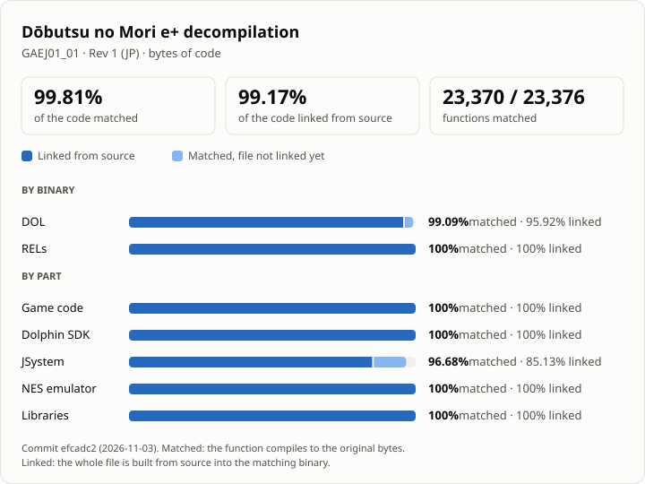

どうぶつの森 e+  
[![Code Progress]][Progress] [![DOL Progress]][Progress] [![REL Progress]][Progress] [![Discord Badge]][discord]
=============

<a href="#progress"><picture>
  <source media="(prefers-color-scheme: dark)" srcset="assets/progress-dark.svg">
  
</picture></a>

<!-- progress-badges:start -->
[Code Progress]: https://img.shields.io/badge/code-99.81%25-256abf
[DOL Progress]: https://img.shields.io/badge/DOL-99.09%25-256abf
[REL Progress]: https://img.shields.io/badge/REL-100%25-256abf
<!-- progress-badges:end -->
[Progress]: #progress
[Discord Badge]: https://img.shields.io/discord/727908905392275526?color=%237289DA&logo=discord&logoColor=%23FFFFFF
[discord]: https://discord.gg/hKx3FJJgrV

A decompilation of どうぶつの森 e+ (Dōbutsu no Mori e+) for the Nintendo GameCube, building byte-for-byte
the game's `static.dol` and its four RELs.

This is a fork of [ACreTeam/afe-decomp](https://github.com/ACreTeam/afe-decomp) in which **Rev 1** (`GAEJ01_01`) is
matched almost completely: all of the game's own code, the Dolphin SDK, the NES emulator and the libraries match, and
only a few JSystem functions are left (see [Progress](#progress)). The upstream project's progress, measured on Rev 0,
is on [decomp.dev](https://decomp.dev/ACreTeam/afe-decomp).

This repository does **not** contain any game assets or assembly whatsoever. An existing copy of the game is required.

Supported versions:

- `GAEJ01_00`: Rev 0 (JP)
- `GAEJ01_01`: Rev 1 (JP), the version this fork matches and the PC/Android port runs

Progress
========

<!-- progress-table:start -->
Measured on `GAEJ01_01`, Rev 1 (JP), at commit `efcadc2` (2026-11-03).

| | Code matched | Code linked | Functions matched | Files linked |
|---|---:|---:|---:|---:|
| **All** | **99.81%** | **99.17%** | 23,370 / 23,376 | 3,020 / 3,041 |
| DOL (`static.dol`) | 99.09% | 95.92% | 3,566 / 3,572 | 370 / 374 |
| RELs (`foresta`, `forestd`, `foresti`, `foresto`) | 100% | 100% | 19,804 / 19,804 | 2,650 / 2,667 |
| Game code | 100% | 100% | 20,036 / 20,036 | 2,662 / 2,663 |
| Dolphin SDK | 100% | 100% | 1,038 / 1,038 | 171 / 171 |
| JSystem | 96.68% | 85.13% | 780 / 786 | 71 / 75 |
| NES emulator | 100% | 100% | 125 / 125 | 4 / 4 |
| Libraries | 100% | 100% | 1,391 / 1,391 | 112 / 112 |

Functions not matched yet (6, all close):

- `JFWDisplay::beginRender` in `JSystem/JFramework/JFWDisplay` (1,288 bytes, 99.84% the same)
- `JUTException::queryMapAddress_single` in `JSystem/JUtility/JUTException` (836 bytes, 99.99% the same)
- `JUTException::showGPRMap` in `JSystem/JUtility/JUTException` (764 bytes, 99.37% the same)
- `CARD_SendOpCond` in `JSystem/JUtility/carddrv` (1,696 bytes, 99.93% the same)
- `CARD_SoftReset` in `JSystem/JUtility/carddrv` (1,428 bytes, 99.76% the same)
- `FS_init_pbs` in `JSystem/JUtility/fs_form` (1,584 bytes, 99.14% the same)

Files with code that are not linked from source yet, so the matching build takes them from the original's assembly: `JSystem/JFramework/JFWDisplay`, `JSystem/JUtility/JUTException`, `JSystem/JUtility/carddrv`, `JSystem/JUtility/fs_form`.

Data: 66.25% of 16.4 MB matched. Most of the rest, 5.1 MB, is in 17 blocks of the RELs' data (mostly in `forestd`, the REL with the game's assets) that are not split into source files yet, so the build takes them from the original's assembly.
<!-- progress-table:end -->

"Matched" counts the functions that compile to the original bytes. "Linked" counts the files that are built from
source into the matching binaries. A file that is not linked yet still comes from the original's assembly in the
matching build, even when most of its functions are matched.

The chart and this table are made from the build's progress report:

```sh
ninja build/GAEJ01_01/report.json
python tools/progress_readme.py
```

PC/Android port
===============

A port of this decompilation to Windows, Linux and Android (with support for the Korean fan translation) lives in
[cailet0422/afe-port](https://github.com/cailet0422/afe-port), which builds against this repository as a submodule.
Its changes to the game code are the `#ifdef TARGET_PC` blocks in `src/` and `include/`; they leave the matching build
unchanged.

<!--
Quick Guides
============

- [Dumping Game Files](./docs/extract_game.md)
- [Ghidra Setup](./docs/ghidra_setup.md)
- [Generating Decomp Context](./docs/generating_decomp_context.md)
- [decomp.me Basics](./docs/decomp_me_basics.md)
- [Ghidra Basics](./docs/ghidra_basics.md)
- [m2c Basics](./docs/m2c_basics.md)
- [Decomp Basics](./docs/decomp_basics.md)
-->

Dependencies
============

Windows
--------

On Windows, it's **highly recommended** to use native tooling. WSL or msys2 are **not** required.  
When running under WSL, [objdiff](#diffing) is unable to get filesystem notifications for automatic rebuilds.

- Install [Python](https://www.python.org/downloads/) and add it to `%PATH%`.
  - Also available from the [Windows Store](https://apps.microsoft.com/store/detail/python-311/9NRWMJP3717K).
- Download [ninja](https://github.com/ninja-build/ninja/releases) and add it to `%PATH%`.
  - Quick install via pip: `pip install ninja`

macOS
------

- Install [ninja](https://github.com/ninja-build/ninja/wiki/Pre-built-Ninja-packages):

  ```sh
  brew install ninja
  ```

[wibo](https://github.com/decompals/wibo), a minimal 32-bit Windows binary wrapper, will be automatically downloaded and used.

Linux
------

- Install [ninja](https://github.com/ninja-build/ninja/wiki/Pre-built-Ninja-packages).

[wibo](https://github.com/decompals/wibo), a minimal 32-bit Windows binary wrapper, will be automatically downloaded and used.

Building
========

- Clone the repository:

  ```sh
  git clone --recursive https://github.com/cailet0422/afe-decomp.git
  ```

- Copy your game's disc image to `orig/GAEJ01_01` (Rev 1) or `orig/GAEJ01_00` (Rev 0).
  - Supported formats: ISO (GCM), RVZ, WIA, WBFS, CISO, NFS, GCZ, TGC
  - After the initial build, the disc image can be deleted to save space.

- Configure:

  ```sh
  python configure.py --version GAEJ01_01
  ```

  Without `--version`, the build is for `GAEJ01_00` (Rev 0).

- Build:

  ```sh
  ninja
  ```

Diffing
=======

Once the initial build succeeds, an `objdiff.json` should exist in the project root.

Download the latest release from [encounter/objdiff](https://github.com/encounter/objdiff). Under project settings, set `Project directory`. The configuration should be loaded automatically.

Select an object from the left sidebar to begin diffing. Changes to the project will rebuild automatically: changes to source files, headers, `configure.py`, `splits.txt` or `symbols.txt`.


Credits
=======

- The [ACreTeam](https://github.com/ACreTeam/afe-decomp) contributors for the decompilation this fork builds on.
- jamchamb, Cuyler36, NWPlayer123 and fraser125 for past documentation of Animal Crossing.
- encounter and NWPlayer123 for [dtk-template](https://github.com/encounter/dtk-template) and setting up the current build system.
